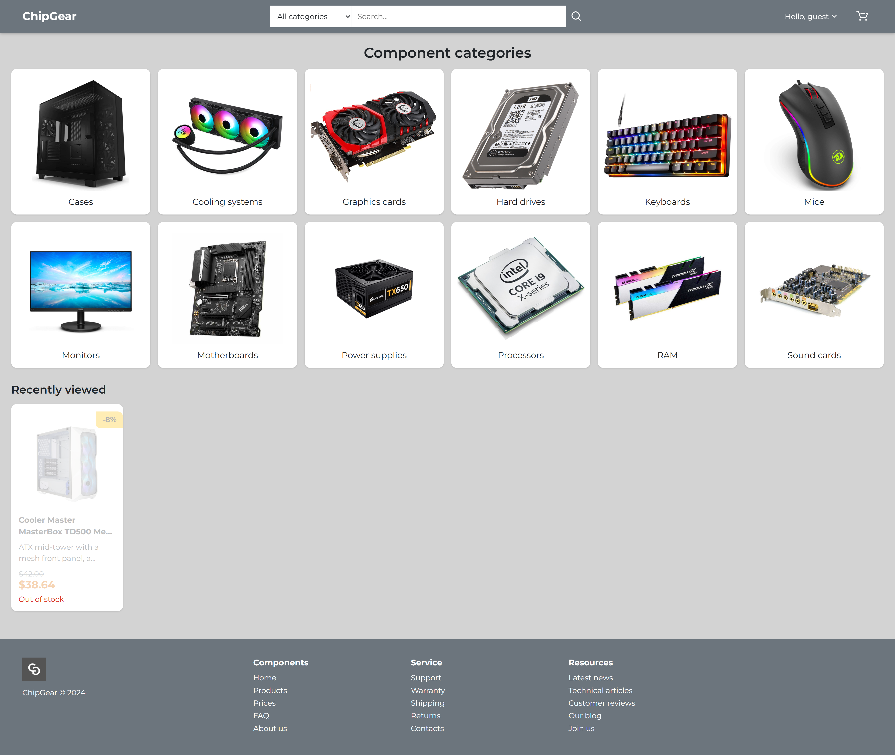
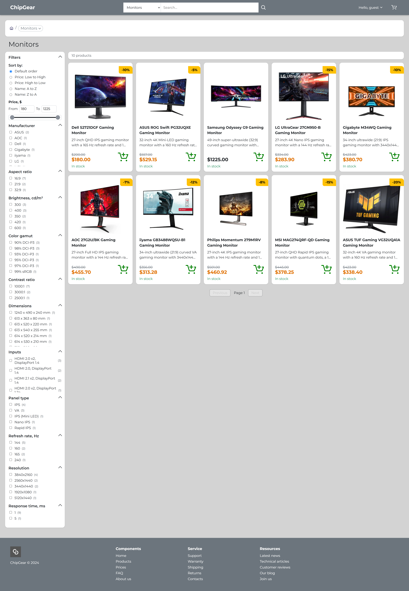
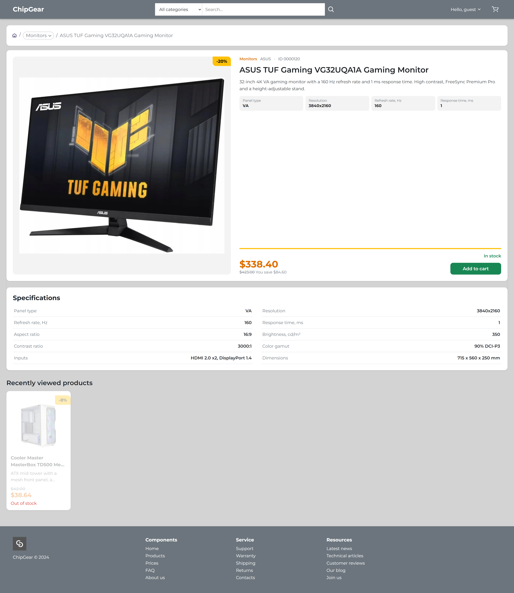
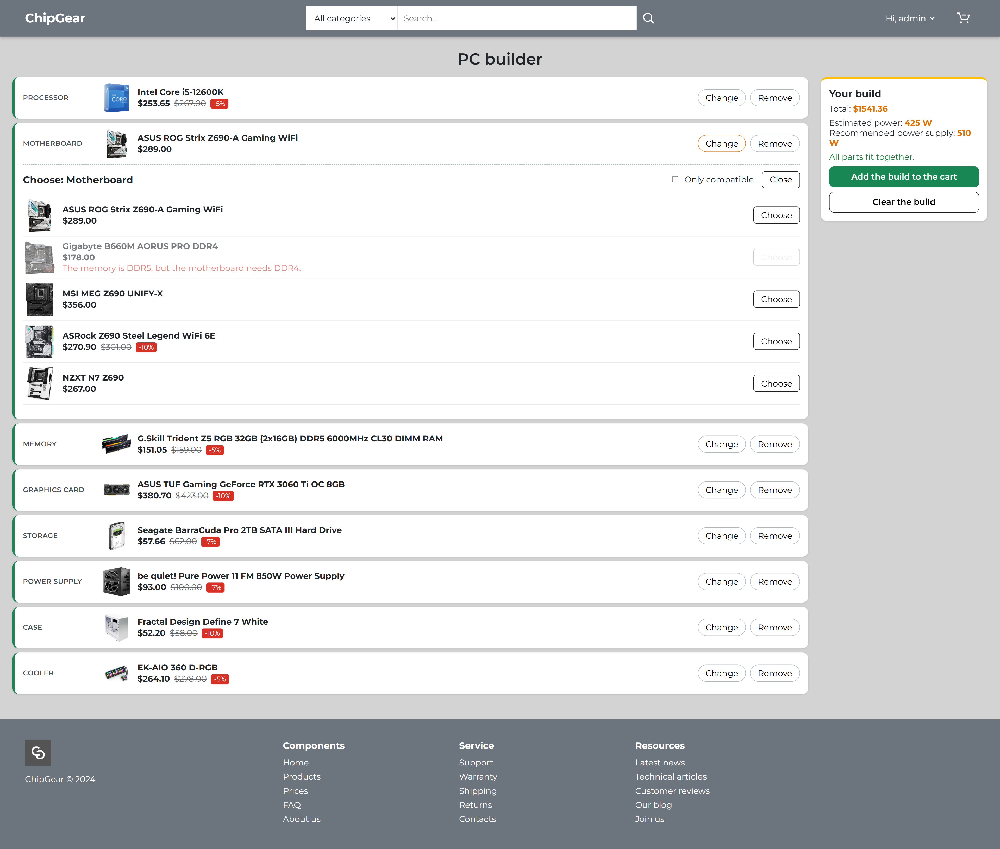
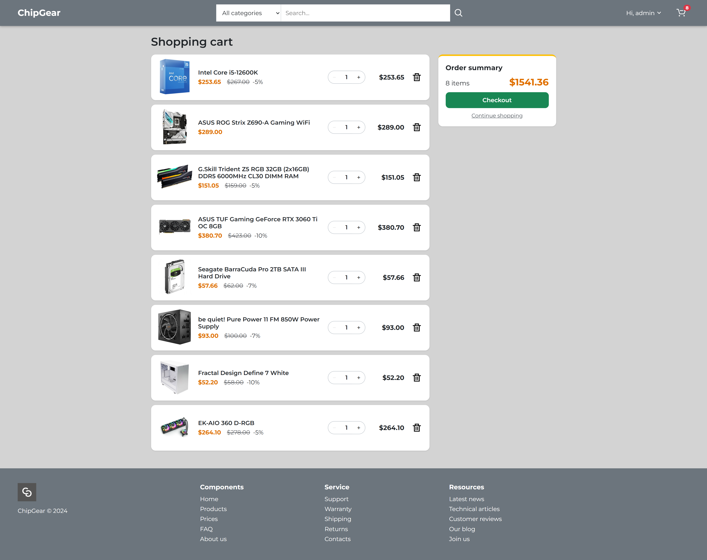
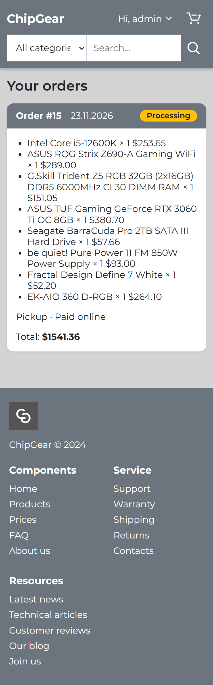

# ChipGear


ChipGear is an online store for computer hardware. The backend is a Django REST API. The frontend is a single-page app built with React 19 and TypeScript.

**Live Demo:** [Visit ChipGear](http://92.5.126.107/)

**Note:** The website is accessible via HTTP only. Use `http://` instead of `https://`.

The first version of the site (server-rendered Django templates) is kept in the branch `legacy-django`.

## Features

- Product catalog with 12 categories, filters (price, manufacturer, specifications), sorting and pagination. Filters are kept in the URL, so every result can be shared.
- Product search with suggestions while you type.
- Product page with images, key specifications and a full specification table.
- "Top sales" on the home page (it appears after enough products have been sold).
- "Customers also buy with this item" (based on real orders) and "Recently viewed" (saved in the database for users and in the session for guests).
- Shopping cart for guests and users, with a quick preview in the header.
- Registration, login and a profile page.
- Checkout and order history.
- PC builder: pick parts for each slot, with compatibility checks (socket, memory type and others), then add the whole build to the cart.
- Sticky header, responsive layout for phones, page titles for every page.
- Django administration panel for products, orders and users.

## Screenshots

### Home


### Product catalog


### Product page


### PC builder


### Shopping cart


### Mobile layout


The folder `screenshots/` keeps the interface of the first version of the site.

## Technologies

**Backend**

- Python 3.10 or newer (production runs on Python 3.10)
- Django 4.2 and Django REST Framework
- SQLite
- Pillow
- django-polymorphic and django-nested-admin (the admin panel)
- django-debug-toolbar (development)

**Frontend**

- React 19 and TypeScript (strict mode)
- Vite
- React Router
- TanStack Query (server state, caching)
- Plain CSS with design tokens, no UI library

**Tooling**

- GitHub Actions: backend tests and the frontend build on every push

## Installation and Setup

### 1. Clone the repository

```bash
git clone https://github.com/Dynam1keee/ChipGear.git
cd ChipGear
```

### 2. Check Python version

**Python 3.10 or newer is required to run this project.** The production server uses Python 3.10.

Check your Python version:

```bash
python --version
```

Make sure the output shows Python 3.10 or a newer version before proceeding.

### 3. Create a virtual environment

**Windows:**

```bash
py -3 -m venv .venv
.venv\Scripts\activate
```

**Linux / macOS:**

```bash
python3 -m venv .venv
source .venv/bin/activate
```

### 4. Install dependencies

```bash
python -m pip install --upgrade pip
pip install -r requirements.txt
```

### 5. Configure environment variables

Create a `.env` file in the project root directory.

Generate a Django secret key by running:

```bash
python -c "from django.core.management.utils import get_random_secret_key; print(get_random_secret_key())"
```

Copy the generated key and add the following variables to your `.env` file:

```env
DJANGO_SECRET_KEY=your-generated-secret-key
DJANGO_DEBUG=True
DJANGO_ALLOWED_HOSTS=localhost,127.0.0.1
```

Replace `your-generated-secret-key` with the key generated in the previous step.

`DJANGO_SECRET_KEY` is required. `DJANGO_DEBUG` enables development mode, and `DJANGO_ALLOWED_HOSTS` specifies the allowed host names.

**Note:** `DJANGO_DEBUG=True` is intended for local development only. Do not enable it in a production environment.

The `.env` file should not be committed to the repository.

### 6. Apply database migrations

The repository includes an SQLite database (`db.sqlite3`) with the initial product catalog data. You do not need to create or import the database manually.

Run:

```bash
python manage.py migrate
```

### 7. Run the development server

```bash
python manage.py runserver
```

Open the application in your browser:

http://127.0.0.1:8000/

## Frontend (React + TypeScript)

The frontend lives in the `frontend/` folder and uses the JSON API under `/api/`. It needs Node.js 20 or newer.

Start Django and the frontend in two terminals:

```bash
# terminal 1 (project root)
python manage.py runserver

# terminal 2
cd frontend
npm ci
npm run dev
```

Open http://localhost:5173. Vite forwards `/api`, `/admin`, `/static` and `/media` to Django on port 8000, so no CORS settings are needed.

Use `npm ci` (not `npm install`): it installs the exact versions from `package-lock.json`. To check types and build the production bundle:

```bash
npm run build
```

### API

All endpoints are under `/api/`. Authentication uses Django sessions with CSRF protection.

| Endpoint | Purpose |
| --- | --- |
| `categories/`, `filters/` | Categories and filter options |
| `products/`, `products/<slug>/` | Product list (filters, sorting, pages) and one product |
| `products/<slug>/related/`, `products/<slug>/view/` | Bought together, and recording a product view |
| `search-suggestions/`, `top-sales/`, `recently-viewed/` | Search hints, top sales, viewing history |
| `auth/csrf/`, `me/`, `login/`, `register/`, `logout/` | Accounts |
| `cart/`, `cart/items/`, `cart/items/<id>/` | Cart |
| `orders/` | Order history and checkout |
| `builder/`, `builder/<slot>/`, `builder/<slot>/options/`, `builder/add-to-cart/` | PC builder |

### Known limitations

- It is a single-page app without server-side rendering, so search engines and link previews see only the general page title and description.
- There is no rate limiting on login.
- Products without a photo show a placeholder image.

## Running tests

Set the same environment variables as for the development server (at least `DJANGO_SECRET_KEY`) and run:

```bash
python manage.py test
```

The same tests and the frontend build run in GitHub Actions on every push. A push to `main` also deploys the site; see [deploy/README.md](deploy/README.md).

## Administration

To create an administrator account, run:

```bash
python manage.py createsuperuser
```

Then start the development server and open:

http://127.0.0.1:8000/admin/

**Note:** the SQLite database is committed to the repository. If you create an administrator account to edit products, delete it before you commit `db.sqlite3`, so the password hash does not end up in git.

## Static and Media Files

Uploaded product images live in `media/`; during development Django serves them when `DJANGO_DEBUG=True`.
The only static files Django has left are those of the admin panel. For deployment collect them with:

```bash
python manage.py collectstatic --noinput
```

## Project Structure

```text
ChipGear/
│
├── api/                # JSON API (DRF) used by the React app
├── builder/            # PC builder: compatibility rules and saved builds
├── carts/              # Shopping cart models and helpers
├── goods/              # Product catalog and categories (models, admin)
├── orders/             # Orders (models, admin)
├── users/              # User model and forms
├── site_app/           # Project configuration and settings
├── frontend/           # React + TypeScript single-page app
│   └── src/            # pages/, components/, api.ts (requests), queries.ts (TanStack Query)
│
├── fixtures/           # Project fixtures
├── media/              # Uploaded media files
├── docs/screenshots/   # Screenshots for this README
├── screenshots/        # Screenshots of the first version of the site
│
├── db.sqlite3          # SQLite database
├── manage.py
├── requirements.txt
└── .env                # Environment variables (not included in repository)
```
