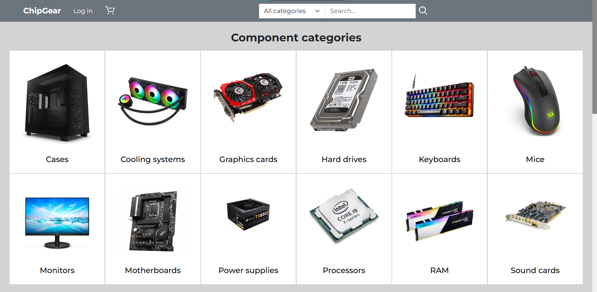
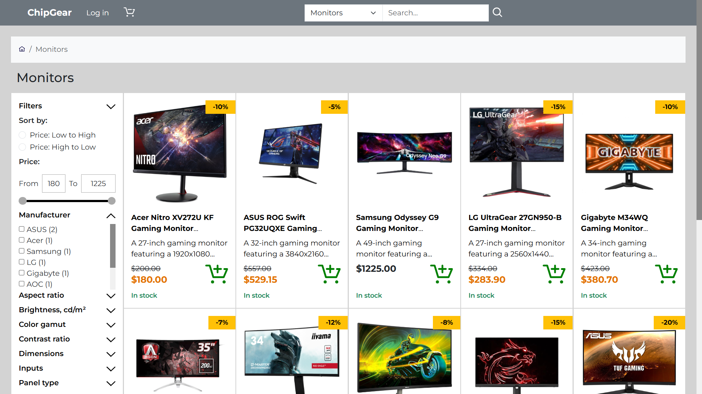
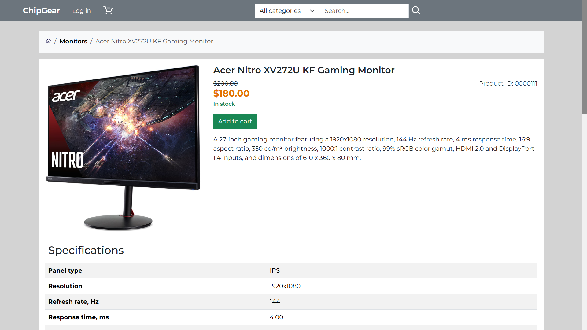
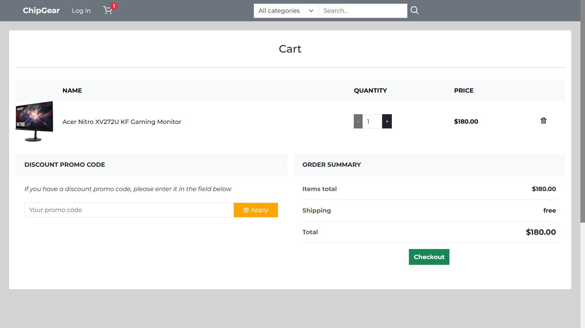
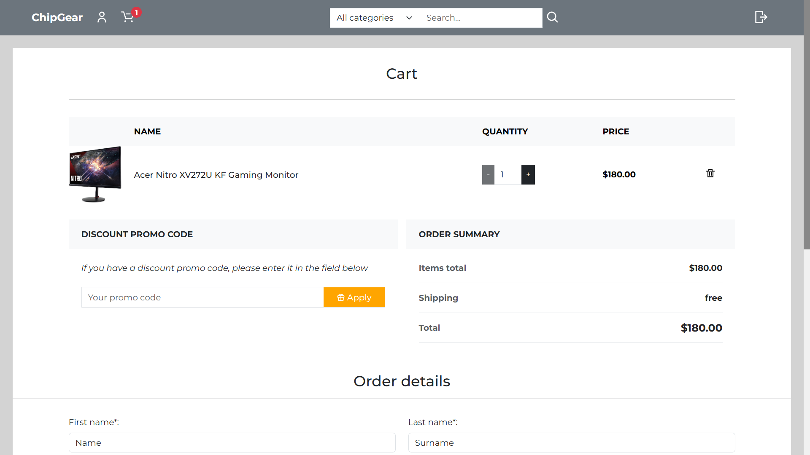

# ChipGear


ChipGear is an online store for computer hardware and accessories, built with Django.

**Live Demo:** [Visit ChipGear](http://92.5.126.107/)

**Note:** The website is currently accessible via HTTP only. Use `http://` instead of `https://`.

The project provides a platform for browsing computer components, searching and filtering products, managing a shopping cart, and placing orders.

## Features

- Product catalog with categories.
- Product search.
- Product filtering, including price filtering.
- Product details with images and specifications.
- Shopping cart management.
- User registration and authentication.
- Order creation and management.
- Django administration panel.

## Screenshots

### Homepage


### Product Catalog


### Product Details


### Shopping Cart


### Checkout


## Technologies

- Python 3.10 or newer (production runs on Python 3.10)
- Django 4.2
- SQLite
- HTML, CSS, JavaScript
- Pillow
- django-debug-toolbar
- django-nested-admin
- django-polymorphic

## Installation and Setup

### 1. Clone the repository

```bash
git clone https://github.com/Dynam1keee/ChipGear.git
cd ChipGear
```

### 2. Check Python version

**Python 3.10 or newer is required to run this project.** The production server uses Python 3.10.

Check your Python version:

```bash
python --version
```

Make sure the output shows Python 3.10 or a newer version before proceeding.

### 3. Create a virtual environment

**Windows:**

```bash
py -3 -m venv .venv
.venv\Scripts\activate
```

**Linux / macOS:**

```bash
python3 -m venv .venv
source .venv/bin/activate
```

### 4. Install dependencies

```bash
python -m pip install --upgrade pip
pip install -r requirements.txt
```

### 5. Configure environment variables

Create a `.env` file in the project root directory.

Generate a Django secret key by running:

```bash
python -c "from django.core.management.utils import get_random_secret_key; print(get_random_secret_key())"
```

Copy the generated key and add the following variables to your `.env` file:

```env
DJANGO_SECRET_KEY=your-generated-secret-key
DJANGO_DEBUG=True
DJANGO_ALLOWED_HOSTS=localhost,127.0.0.1
```

Replace `your-generated-secret-key` with the key generated in the previous step.

`DJANGO_SECRET_KEY` is required. `DJANGO_DEBUG` enables development mode, and `DJANGO_ALLOWED_HOSTS` specifies the allowed host names.

**Note:** `DJANGO_DEBUG=True` is intended for local development only. Do not enable it in a production environment.

The `.env` file should not be committed to the repository.

### 6. Apply database migrations

The repository includes an SQLite database (`db.sqlite3`) with the initial product catalog data. You do not need to create or import the database manually.

Run:

```bash
python manage.py migrate
```

### 7. Run the development server

```bash
python manage.py runserver
```

Open the application in your browser:

http://127.0.0.1:8000/

## Frontend (React + TypeScript, work in progress)

The new frontend lives in the `frontend/` folder and uses the JSON API under `/api/`. It needs Node.js 20 or newer.

Start Django and the frontend in two terminals:

```bash
# terminal 1 (project root)
python manage.py runserver

# terminal 2
cd frontend
npm install
npm run dev
```

Open http://localhost:5173. Vite forwards `/api` and `/media` to Django on port 8000, so no CORS settings are needed.

## Running tests

Set the same environment variables as for the development server (at least `DJANGO_SECRET_KEY`) and run:

```bash
python manage.py test
```

## Administration

To create an administrator account, run:

```bash
python manage.py createsuperuser
```

Then start the development server and open:

http://127.0.0.1:8000/admin/

## Static and Media Files

Uploaded product images live in `media/`; during development Django serves them when `DJANGO_DEBUG=True`.
The only static files Django has left are those of the admin panel. For deployment collect them with:

```bash
python manage.py collectstatic --noinput
```

## Project Structure

```text
ChipGear/
│
├── api/                # JSON API (DRF) used by the React app
├── builder/            # PC builder: compatibility rules and saved builds
├── carts/              # Shopping cart models and helpers
├── goods/              # Product catalog and categories (models, admin)
├── orders/             # Orders (models, admin)
├── users/              # User model and forms
├── site_app/           # Project configuration and settings
├── frontend/           # React + TypeScript single-page app
│
├── fixtures/           # Project fixtures
├── media/              # Uploaded media files
├── screenshots/        # Screenshots of the original interface
│
├── db.sqlite3          # SQLite database
├── manage.py
├── requirements.txt
└── .env                # Environment variables (not included in repository)
```
